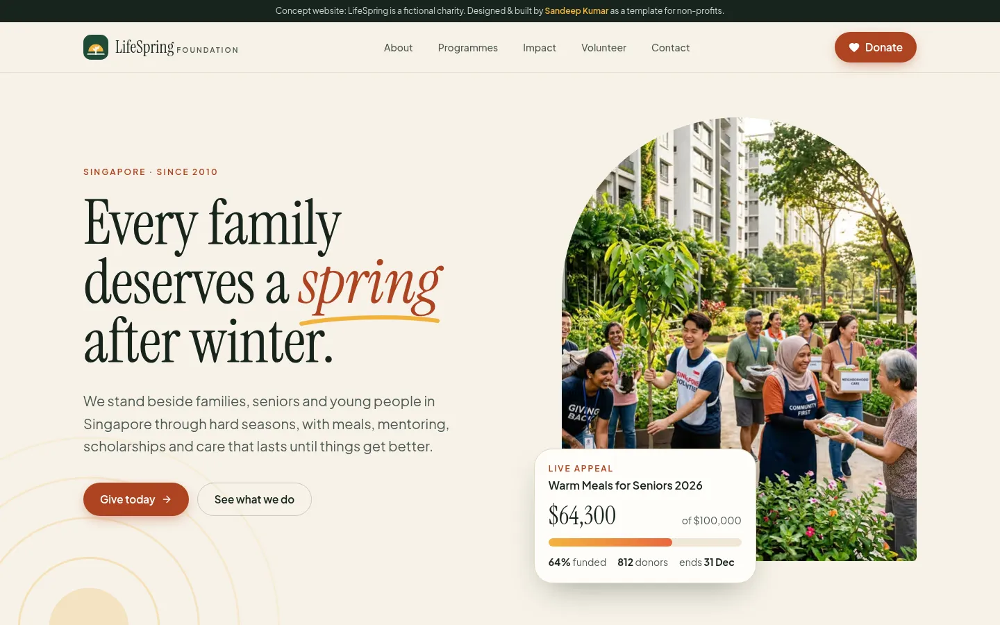

# LifeSpring: a website template for non-profits

A fast, accessible, donation-focused website for charities and NGOs. LifeSpring Foundation is a **fictional** Singapore charity used to show the template; every name, number and story on the demo is made up.

**Live demo:** https://lifespring-foundation.vercel.app



## What's included

| | |
|---|---|
| **Donations** | One-time or monthly, preset and custom amounts, live "what your gift does" text, Stripe Checkout (server-validated amounts; cards, Apple Pay, Google Pay) or any hosted payment link, PayNow UEN option, thank-you page with a monthly upsell |
| **Tax deduction (SG)** | Optional NRIC/FIN/UEN and name for IRAS auto-inclusion, validated on both sides and passed to the payment record |
| **Appeals** | Campaign progress bar with goal, donors and end date |
| **Transparency** | Governance page (UEN, charity no., IPC validity, board, annual reports, policies, Code of Governance), "where every dollar goes", impact numbers, before/after stories, partners |
| **Forms** | Volunteer application, contact and newsletter, emailed via Resend, with validation, a honeypot, rate limiting, PDPA notice and a separate unticked marketing opt-in |
| **Mobile** | Sticky Donate + WhatsApp bar, full-screen menu, tested at 390 px |
| **SEO** | Per-page titles and descriptions, `NGO` structured data, sitemap, robots, Open Graph |
| **Quality** | Lighthouse (mobile) ~90–95 performance, 100 accessibility, best practices and SEO; security headers; keyboard and screen-reader friendly |
| **Typography** | Fraunces (soft editorial serif) for headings, DM Sans for reading; fluid type scale (`display`, `title-1…3`, `figure`) in `globals.css` |

Pages: home, about, programmes, impact, governance, donate (+ thank you), volunteer, contact, privacy, terms, 404.

## Rebrand for a new organisation

1. **Content:** edit [`src/config/site.ts`](src/config/site.ts): name, UEN, IPC validity, contact details, PayNow UEN, programmes, stats, campaign, finances, governance, stories, team, FAQs. Set `demo: false`.
2. **Colours:** change the variables at the top of [`src/app/globals.css`](src/app/globals.css) (`--forest`, `--sunrise`, `--sun`, `--paper`). Keep text colours at 4.5:1 contrast.
3. **Images:** replace `public/hero.png` and `public/about.png` with the organisation's own photos (portrait, about 4:5).
4. **Logo:** update `src/components/site/Logo.tsx` and `src/app/icon.svg`.
5. **Legal:** have the privacy and terms text reviewed for the organisation, and confirm the tax-deduction wording with IRAS's current rules (250% for IPC donations to 31 Dec 2026; Budget 2026 announced an extension to 2029).

## Go live

```bash
cp .env.example .env.local   # fill in the keys you need
npm install
npm run dev                  # http://localhost:3000
```

| To turn on | Set |
|---|---|
| Card payments (one-time + monthly) | `STRIPE_SECRET_KEY` |
| Or a hosted donation page (Giving.sg, Stripe Payment Link…) | `NEXT_PUBLIC_DONATE_URL` |
| Form emails | `RESEND_API_KEY`, `ENQUIRY_TO_EMAIL`, `ENQUIRY_FROM_EMAIL` |
| Correct canonical URLs | `NEXT_PUBLIC_SITE_URL` |

With `demo: true` and no keys, forms and donations show a clear "demo mode" message instead of failing. With `demo: false` and no keys, visitors are asked to email instead.

Deploy on Vercel: import the repo, add the environment variables, deploy.

## Stack

Next.js 16 (App Router) · React 19 · TypeScript · Tailwind CSS 4 · lucide-react. No database; forms and payments use Resend and Stripe over their REST APIs.

```bash
npm run build   # production build
npm run lint    # ESLint
```

---

Designed and built by [Sandeep Kumar](https://github.com/sandeepk2304). Need a site like this for your organisation? Get in touch.
