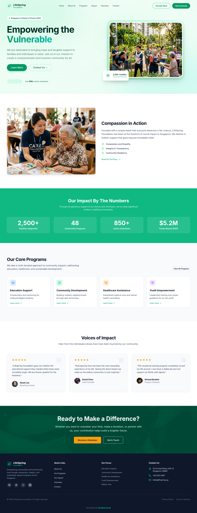

# LifeSpring Foundation | Singapore

<div align="center">
  
  <br />
  <em>A premium, responsive, and highly optimized landing page for a modern charitable foundation.</em>
</div>

<br />

## 🌿 About The Project

**LifeSpring Foundation** is a modern, high-converting corporate website built to represent a Singapore-based charity. The objective was to design an extremely clean, trustworthy, and visually appealing web presence that empowers the community and encourages volunteerism and donations.

The platform relies on a bespoke **Green Theme** (Emerald & Teal), modern micro-animations, and a highly polished UI to leave a lasting, premium impression on visitors.

---

## 🚀 Why Next.js? (Business Value)

When building a high-converting landing page for a foundation or corporate client, performance and visibility are everything. I chose **Next.js** to deliver tangible business benefits:

- **Unmatched SEO & Discoverability:** Unlike standard React apps, Next.js provides Server-Side Rendering (SSR). This means Google and other search engines can instantly crawl the page content, helping the organization rank higher and reach more potential donors organically.
- **Lightning-Fast Load Times:** High bounce rates kill conversions. By leveraging the Next.js App Router and advanced asset optimization, the website loads almost instantly, keeping users engaged.
- **Enterprise-Grade Reliability:** Next.js provides a robust, edge-ready architecture that scales effortlessly. If traffic spikes during a major fundraising campaign, the site remains perfectly stable and fast.

## 💎 Features Implemented & Client Benefits

- **Conversion-Optimized UI:** Designed with sticky, high-visibility Calls-to-Action ("Donate Now", "Get Involved") that naturally guide the user's eye and maximize conversion rates.
- **Trust-Building Aesthetics:** A custom psychology-backed **Green Theme** paired with modern glassmorphism and Framer Motion micro-animations establishes immediate credibility and professionalism—crucial for attracting corporate sponsors.
- **Mobile-First Perfection:** Rebuilt from the ground up using Tailwind CSS v4, ensuring complex interactive layouts (like the dynamic floating header) scale flawlessly to any mobile device, capturing the massive segment of smartphone users.
- **Future-Proof Architecture:** Built with highly modular React UI components. This makes it incredibly easy and cost-effective for a client to add new pages, features, or CMS integrations in the future.

---


## 💻 Tech Stack

This project is built using bleeding-edge web technologies to ensure maximum performance, accessibility, and an incredible developer experience:

- **Framework:** [Next.js 16 (Turbopack)](https://nextjs.org/) - App Router for server-side rendering, advanced routing, and lightning-fast builds.
- **Library:** [React 19](https://react.dev/) - Next-generation React features.
- **Styling:** [Tailwind CSS v4](https://tailwindcss.com/) - Utility-first CSS framework using the brand new CSS-driven `@theme` configuration.
- **UI Architecture:** [Shadcn UI](https://ui.shadcn.com/) & [Base UI](https://base-ui.com/) - Accessible, unstyled, and fully customizable headless components.
- **Animations:** [Framer Motion](https://www.framer.com/motion/) & `tw-animate-css` - For smooth, physics-based micro-interactions and scroll reveals.
- **Icons:** [Lucide React](https://lucide.dev/) - Beautiful, consistent, and lightweight iconography.
- **Typography:** Highly optimized `next/font` (Inter).

---

## ✨ Key Features

- **High-Fidelity UI/UX:** A custom hero section featuring soft abstract green gradients, floating interaction badges, and precise visual hierarchy.
- **Dynamic Navigation:** A highly responsive header that transitions from transparent to a floating "glassmorphic" pill layout upon scrolling.
- **Component-Driven Design:** Clean, modular React components for immense reusability (Buttons, Logos, Cards).
- **Extension-Safe Hydration:** Robust Next.js setup that safely handles third-party browser extensions (like ColorZilla or Dark Reader) via root-level hydration wrappers.
- **Fully Responsive:** Flawless scaling from small mobile devices up to ultra-wide desktop monitors without breaking layout integrity.

---

## 🚀 Getting Started

### Prerequisites
Make sure you have [Node.js](https://nodejs.org/) installed (v20+ recommended).

### Installation

1. **Clone the repository**
   ```bash
   git clone https://github.com/yourusername/lifespring-foundation.git
   ```

2. **Navigate to the project directory**
   ```bash
   cd lifespring-foundation
   ```

3. **Install dependencies**
   ```bash
   npm install
   ```

### Running the Development Server

```bash
npm run dev
```

Open [http://localhost:3000](http://localhost:3000) (or whichever port Next.js assigns) with your browser to see the result.

### ☁️ Deployment (Vercel)

This project is highly optimized for seamless deployment on [Vercel](https://vercel.com/), the native hosting platform for Next.js. 

1. Push your code to a GitHub, GitLab, or Bitbucket repository.
2. Log in to Vercel and click **Add New...** > **Project**.
3. Import your repository.
4. Vercel will automatically detect the **Next.js** framework and configure the correct build settings (`npm run build`).
5. Click **Deploy**.

*Zero-config deployments are fully supported out of the box, taking full advantage of Vercel's Edge Network for instant, globally cached delivery.*

---

## 📂 Project Structure

- **`src/app/`**: Next.js App Router definitions (`page.tsx`, `layout.tsx`, global CSS variables).
- **`src/components/ui/`**: Reusable, atomic UI elements (`Button.tsx`, `logo.tsx`).
- **`src/components/layout/`**: Structural components responsible for page framing (`Header.tsx`, `Footer.tsx`).
- **`public/`**: Static assets, graphics, and images.

---

## 🤝 Need a Custom Website?

Are you looking to build a premium, high-converting web application for your business or non-profit? Or perhaps you need customizations, support, or integrations added to a project like this?

I specialize in building tailored, high-performance web experiences that drive real business results.

📩 **Let's discuss your project!** Feel free to reach out to me for freelance inquiries, customizations, or technical consulting.
